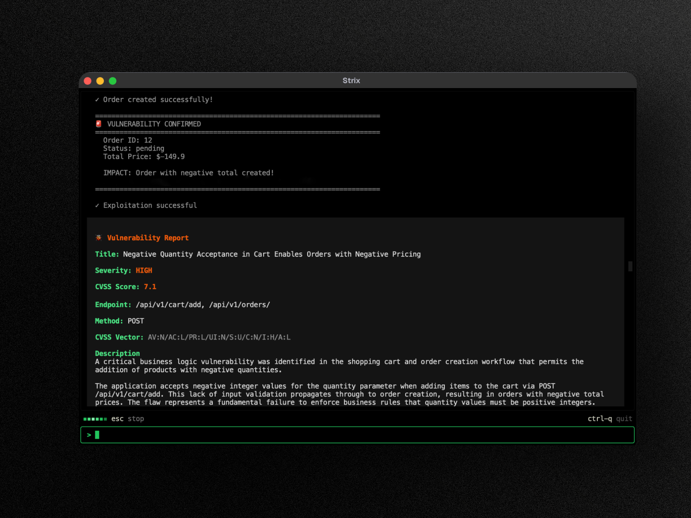

<p align="center">
  <a href="https://github.com/Ghanott/Pentesin/">
    
  </a>
</p>

<div align="center">

# pentesin

### The open-source AI pentesting tool. Autonomous AI hackers that find and fix your app’s vulnerabilities.

<br/>


<a href="https://github.com/Ghanott/Pentesin/tree/main/docs"></a>
<a href="https://github.com/Ghanott/Pentesin"></a>
[](https://github.com/Ghanott/Pentesin/issues)


<a href="https://github.com/Ghanott/Pentesin"></a>
<a href="LICENSE"></a>
<a href="https://pypi.org/project/pentesin-agent/"></a>


</div>


> [!TIP]
> **New!** pentesin integrates seamlessly with GitHub Actions and CI/CD pipelines. Automatically scan for vulnerabilities on every pull request and block insecure code before it reaches production - [Get started with no setup required](https://github.com/Ghanott/Pentesin#readme).

---


## pentesin Overview

pentesin are autonomous AI penetration testing agents that act just like real hackers - they run your code dynamically, find vulnerabilities, and validate them through actual proofs-of-concept. Built for developers and security teams who need fast, accurate security testing without the overhead of manual pentesting or the false positives of static analysis tools.

**Key Capabilities:**

- **Full pentesting toolkit** - reconnaissance, exploitation, and validation out of the box
- **Multi-agent orchestration** - teams of AI pentesters that collaborate and scale
- **Real exploit validation** - working PoCs, not false positives like legacy vulnerability scanners
- **Developer‑first CLI** - actionable findings with remediation guidance
- **Auto‑fix & reporting** - generate patches and compliance-ready pentest reports


<br>


<div align="center">
  <a href="https://github.com/Ghanott/Pentesin">
    
  </a>
</div>


## Use Cases

- **Application Security Testing** - Detect and validate critical vulnerabilities in your applications
- **Rapid Penetration Testing** - Get penetration tests done in hours, not weeks, with compliance reports
- **Bug Bounty Automation** - Automate bug bounty research and generate PoCs for faster reporting
- **CI/CD Integration** - Run tests in CI/CD to block vulnerabilities before reaching production

## 🚀 Quick Start

**Prerequisites:**
- Docker (running)
- An LLM API key from any [supported provider](https://github.com/Ghanott/Pentesin/tree/main/docs/llm-providers/overview) (OpenAI, Anthropic, Google, etc.)

### Installation & First Scan

```bash
# Install pentesin
curl -sSL https://raw.githubusercontent.com/Ghanott/Pentesin/main/scripts/install.sh | bash

# Configure your AI provider
export PENTESIN_LLM="openrouter/z-ai/glm-5.3"
export LLM_API_KEY="your-api-key"

# Run your first security assessment
pentesin --target https://your-app.com
```

> [!IMPORTANT]
> This build is **black-box only**. Targets are live URLs, domains, IPs, or
> OpenAPI/Swagger/Postman contracts used only as endpoint maps. Contract-declared
> HTTP(S) servers enter scope; source directories and Git repositories are
> rejected. Only scan targets you are authorized to test.

> [!NOTE]
> First run automatically pulls the sandbox Docker image. Results are saved to `pentesin_runs/<run-name>`

### Updating

```bash
# Self-update the standalone binary to the latest release
pentesin --update

# ...or re-run the installer
curl -sSL https://raw.githubusercontent.com/Ghanott/Pentesin/main/scripts/install.sh | bash
```

Installed with pipx, uv, or pip? `pentesin --update` prints the matching upgrade command instead (`pipx upgrade pentesin-agent`, `uv tool upgrade pentesin-agent`, `pip install --upgrade pentesin-agent`). pentesin also shows a notice with the right command when a new version is available.

---

## Ways to Run pentesin

- **Open Source** - free, runs locally with Docker and your own LLM key. [Quick Start](https://github.com/Ghanott/Pentesin/tree/main/docs/quickstart)
- **pentesin Cloud** - no setup, validated findings, one-click autofix, and PR reviews. [Run a pentest →](https://github.com/Ghanott/Pentesin#readme)

---

## ☁️ pentesin Cloud

The `pentesin cloud` commands talk to a relay at `PENTESIN_APP_URL`. This fork
ships no hosted relay, so set that variable to a compatible deployment you
operate before using them.

## 🤖 Use pentesin from Your Coding Agent

pentesin is agent-ready. Give Claude Code, Cursor, Codex, or any [SKILL.md-compatible](https://agentskills.io) agent the ability to run pentests, fix findings, and set up CI scanning:

```bash
npx skills add Ghanott/Pentesin
```

This installs nine skills for running pentests, fixing findings, and CI scanning, against code, web apps, APIs, and the OWASP Top 10. Agents can use the local CLI or the managed cloud with the same engine.

See [`AGENTS.md`](AGENTS.md) for the quick reference, [docs](https://github.com/Ghanott/Pentesin/tree/main/docs) for the CLI, and [docs](https://github.com/Ghanott/Pentesin/tree/main/docs/integrations) for the API.

---

## ✨ Features

### Agentic Pentesting Tools

pentesin agents come equipped with a comprehensive offensive security toolkit - the same tools used by professional penetration testers and ethical hackers:

- **HTTP Interception Proxy** - Full request/response manipulation and analysis with Caido
- **Browser Exploitation** - Automated browser for testing XSS, CSRF, clickjacking, and auth bypass flows
- **Shell & Command Execution** - Interactive terminal for exploit development and post-exploitation
- **Custom Exploit Runtime** - Python sandbox for writing and validating proof-of-concept exploits
- **Reconnaissance & OSINT** - Automated attack surface mapping, subdomain enumeration, and fingerprinting
- **Static & Dynamic Code Analysis** - SAST + DAST capabilities for comprehensive application security testing
- **Vulnerability Knowledge Base** - Structured findings with CVSS scoring and OWASP classification

### Comprehensive Vulnerability Scanner

pentesin identifies, validates, and exploits a wide range of security vulnerabilities across the OWASP Top 10 and beyond:

- **Broken Access Control** - IDOR, privilege escalation, auth bypass
- **Injection Attacks** - SQL injection, NoSQL injection, OS command injection, SSTI
- **Server-Side Vulnerabilities** - SSRF, XXE, insecure deserialization, RCE
- **Client-Side Attacks** - XSS (stored/reflected/DOM), prototype pollution, CSRF
- **Business Logic Flaws** - Race conditions, payment manipulation, workflow bypass
- **Authentication & Session** - JWT attacks, session fixation, credential stuffing vectors
- **Infrastructure & Cloud** - Misconfigurations, exposed services, cloud security issues
- **API Security** - Broken authentication, mass assignment, rate limiting bypass

### Graph of Agents (Multi-Agent Pentesting)

Advanced multi-agent orchestration for comprehensive automated penetration testing:

- **Distributed Pentesting** - Specialized AI agents for recon, exploitation, and post-exploitation
- **Scalable Security Testing** - Parallel execution across multiple targets for fast, comprehensive coverage
- **Dynamic Coordination** - Agents share discoveries, chain vulnerabilities, and collaborate like a red team

---

## 🖥️ Local Web Viewer

Every scan writes its results to disk as it runs. Bring them up in a local dashboard with a single command:

```bash
# Open the most recent run
pentesin view

# ...or open a specific run by name
pentesin view my-run-name

# Expose the viewer on all IPv4 interfaces at a fixed port
pentesin view --host 0.0.0.0 --port 8080 --no-open
```

The dashboard shows the findings, a live map of the agent team, and past runs. Nothing leaves your machine, and the UI ships prebuilt. `pentesin view` binds to `127.0.0.1` and prints a tokened link that grants access to the run, so share it carefully.

See the [viewer documentation](https://github.com/Ghanott/Pentesin/tree/main/docs/usage/viewer) for the options and for reaching the viewer from another machine.

---

## Usage Examples

### Basic Usage

```bash
# Black-box web application assessment
pentesin --target https://your-app.com

# Domain or IP
pentesin --target example.com
pentesin --target 192.168.1.42

# Several live targets at once
pentesin --target https://staging.your-app.com --target https://your-app.com

# API pentest from a sanitized OpenAPI/Postman endpoint map
pentesin --target ./openapi.yaml
pentesin --target ./collection.postman_collection.json
```

### Xray scanner

This fork integrates the [Chaitin Xray](https://github.com/chaitin/xray) community
scanner. Its Xray binary is pinned to `1.9.11` and checksum-verified during the
sandbox image build. Integration requires attribution and acceptance of Xray's
[license](https://github.com/chaitin/xray/blob/master/LICENSE.md) and
[disclaimer](https://github.com/chaitin/xray/blob/master/Disclaimer.md).
After reviewing those terms, opt in explicitly:

```bash
export PENTESIN_XRAY_TERMS_ACCEPTED=true
```

Only scan targets you are authorized to test. Agents use `xray_scan` on a target
already in the run scope, optionally probing a baseline 403 for reachability
bypasses. Results are candidate evidence—not validated vulnerabilities—and
Xray does not emit a normalized severity. See
`pentesin/skills/custom/xray_scanner.md` for workflow and limits.


### Advanced Testing Scenarios

```bash
# Grey-box authenticated testing
pentesin --target https://your-app.com --instruction "Perform authenticated testing using credentials: user:pass"

# API contract target (declared servers become scope)
pentesin -t ./openapi.yaml -t https://your-app.com

# Multi-target black-box testing
pentesin -t https://staging.your-app.com -t https://your-app.com

# Targets from a file, one target per non-empty, non-comment line
pentesin --target-list ./targets.txt
```

See the [CLI reference](https://github.com/Ghanott/Pentesin/tree/main/docs/usage/cli) for every option, including scan modes, diff scope, instruction files, and budgets.

### Headless Mode

Run pentesin programmatically without interactive UI using the `-n/--non-interactive` flag - perfect for servers and automated jobs. The CLI prints real-time vulnerability findings and the final report before exiting. Exits with non-zero code when vulnerabilities are found.

```bash
pentesin -n --target https://your-app.com
```

### CI/CD (GitHub Actions)

pentesin can be added to your pipeline to run a security test on pull requests with a lightweight GitHub Actions workflow:

```yaml
name: pentesin-penetration-test

on:
  pull_request:

jobs:
  security-scan:
    runs-on: ubuntu-latest
    steps:
      - uses: actions/checkout@v6
        with:
          fetch-depth: 0

      - name: Install pentesin
        run: curl -sSL https://raw.githubusercontent.com/Ghanott/Pentesin/main/scripts/install.sh | bash

      - name: Run pentesin
        env:
          PENTESIN_LLM: ${{ secrets.PENTESIN_LLM }}
          LLM_API_KEY: ${{ secrets.LLM_API_KEY }}

        run: pentesin -n -t ./ --scan-mode quick
```

> [!TIP]
> In CI pull request runs, pentesin automatically scopes quick reviews to changed files, which is why the
> checkout above fetches full history. See the
> [CI/CD documentation](https://github.com/Ghanott/Pentesin/tree/main/docs/integrations/github-actions) for the details.

### Configuration

```bash
export PENTESIN_LLM="openrouter/z-ai/glm-5.3"
export LLM_API_KEY="your-api-key"

# Optional
export LLM_API_BASE="your-api-base-url"  # if using a local model, e.g. Ollama, LMStudio
```

> [!NOTE]
> pentesin automatically saves your configuration to `~/.pentesin/cli-config.json`, so you don't have to re-enter it on every run.
> See the [configuration reference](https://github.com/Ghanott/Pentesin/tree/main/docs/advanced/configuration) for every environment variable.

#### Sign in with a ChatGPT subscription

Instead of a metered API key, you can run pentesin on your ChatGPT Plus/Pro subscription:

```bash
pentesin auth login chatgpt             # sign in with your ChatGPT account
export PENTESIN_LLM="chatgpt/gpt-5.4"   # chatgpt/<model> runs on the subscription
pentesin auth status                    # show the active sign-in, or logout to forget it
```

#### Use the managed platform: `pentesin cloud`

Run scans through a relay from the terminal, without Docker or an LLM key (requires `PENTESIN_APP_URL`):

```bash
pentesin cloud login                                  # browser sign-in, one credential per install
pentesin cloud scans start --source . --yes --wait    # scan local code, approving the upload
pentesin cloud scans start --engagement-type live_test --domain-ids <uuid> --wait
pentesin cloud vulns list --severity critical
```

Every [REST API](https://github.com/Ghanott/Pentesin/tree/main/docs/integrations) operation has a matching `pentesin cloud <resource> <verb>` command. Run `pentesin cloud` to list the resources, and add `help` to a resource to list its verbs. Output is JSON when stdout is not a terminal or when you pass `--json`. Binary downloads are the exception: redirect the raw bytes, or combine `--output FILE --json` for download metadata.

Cloud commands require `PENTESIN_APP_URL` pointing at a compatible relay you operate.

#### Connect your own MCP servers

pentesin can connect to Model Context Protocol (MCP) servers you list and expose their tools to the agent during a run. Create `~/.pentesin/mcp-servers.json` with a JSON list of local `stdio` servers or remote `http` servers:

```json
[
  {
    "name": "github",
    "transport": "http",
    "url": "https://api.githubcopilot.com/mcp/",
    "auth": { "kind": "bearer", "token": "your-token" },
    "allowed_tools": ["list_issues"]
  }
]
```

Each server's tools are namespaced by `name`, for example `github_list_issues`. See the [MCP documentation](https://github.com/Ghanott/Pentesin/tree/main/docs/integrations/mcp) for the full schema, tool filtering, and `stdio` servers.

**Recommended models for best results:**

- [Z.ai GLM-5.3 on OpenRouter](https://openrouter.ai/z-ai/glm-5.3) - `openrouter/z-ai/glm-5.3` (the default pick)
- [OpenAI GPT-5.4](https://openai.com/api/) - `openai/gpt-5.4`
- [Anthropic Claude Sonnet 4.6](https://claude.com/platform/api) - `anthropic/claude-sonnet-4-6`
- [Google Gemini 3 Pro Preview](https://cloud.google.com/vertex-ai) - `vertex_ai/gemini-3-pro-preview`
- [DeepSeek V4 Pro](https://platform.deepseek.com) - `deepseek/deepseek-v4-pro`
- [Moonshot Kimi K3](https://platform.kimi.ai) - `moonshot/kimi-k3`

See the [LLM Providers documentation](https://github.com/Ghanott/Pentesin/tree/main/docs/llm-providers/overview) for all supported providers including Vertex AI, Bedrock, Azure, and local models.

## Documentation

Full documentation is available at **[the docs directory](https://github.com/Ghanott/Pentesin/tree/main/docs)** - including detailed guides for usage, CI/CD integrations, skills, and advanced configuration.

## Contributing

We welcome contributions of code, docs, and new skills - check out our [Contributing Guide](https://github.com/Ghanott/Pentesin/tree/main/docs/contributing) to get started or open a [pull request](https://github.com/Ghanott/Pentesin/pulls)/[issue](https://github.com/Ghanott/Pentesin/issues).

## Community

Have questions? Found a bug? Want to contribute? **[open an issue](https://github.com/Ghanott/Pentesin/issues)**

## Support the Project

**Love pentesin?** Give us a ⭐ on GitHub!

## Acknowledgements

pentesin builds on the incredible work of open-source projects like [LiteLLM](https://github.com/BerriAI/litellm), [Caido](https://github.com/caido/caido), [Nuclei](https://github.com/projectdiscovery/nuclei), [Playwright](https://github.com/microsoft/playwright), and [Bubble Tea](https://github.com/charmbracelet/bubbletea). Huge thanks to their maintainers!


> [!WARNING]
> **Authorized use only.** pentesin actively tests the targets you point it at, so only run it against systems you own or have **explicit, written permission** to test, and stay within the agreed scope. Unauthorized testing is illegal in most jurisdictions.
> You alone are responsible for obtaining authorization and complying with the law. pentesin is provided "as is" with no warranty or liability for misuse.

</div>
